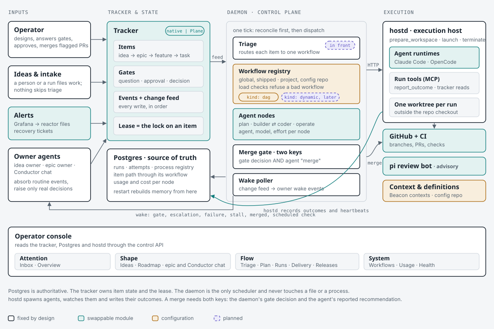

A random note on my recent effort to fight attention gates in my harness. Not a conclusion, just where I am right now.

<!--more-->

## Background

I'm building a "software factory", agentic-conductor. I only call it that because I genuinely don't have a better word. My friends call it Ring internally. It's the outer harness I talked about in log 4.

Conductor is built to run things async and only prompt me when needed. The hard part is *when is needed*, and what to change when I get it wrong. The gates sit in the idea grill and the delivery chat (which is scoped to one epic), and the Inbox is where they land. See [AI Log 4]() for the layers, and for why attention is the scarce resource.

## How conductor works, briefly

Work enters as tracker items: idea, epic, feature, task. Nothing skips triage. Triage routes each item to one fixed workflow, which is a graph of agent nodes with capped loops. The daemon dispatches the nodes, and hostd runs the agents, each in its own worktree. Postgres is the source of truth, so after a restart everything is rebuilt from it.

Only a few fixed server nodes hold authority: route, merge and production. A PR merges only when two keys turn, the daemon's gate decision and the agent's own "merge" recommendation. That's the reason I can let agents run unattended at all.

I get pulled back in through the **wake loop**. A write to the tracker lands in the change feed, a poller wakes the owner agent of that epic, and the agent either handles it or opens a gate for me. Gates show up in the Inbox with options and a recommended choice. In the diagram, my attention goes to the Operator box, the Gates inside the tracker, and the wake edge that loops back from the daemon to the owner agents.

## The trust curve

Lauren Tan's (poteto) [trust curve](https://sozai.app/transcript/spacex-ai-engineer-lauren-tan-part-1/): over five months she went from micromanaging agents to letting them merge their own PRs. If you don't trust the output, "the mode of operation I'm going to be in is micromanagement", and "you can't go to a hundred agents... when you don't even trust the output of one agent." Her way up is verification.

What I'd add is **attention**. I think trust and attention are two sides of one coin. When I don't trust the output, my attention is the safety net, so I spend it on every step. As trust grows, I get that attention back. Every gate is a spot where I haven't extended trust yet, and I pay for it with my attention.

## Three layers of fix, from probabilistic to deterministic

When an agent behaves wrongly, I try to pause and think about refining the agent, instead of just patching the output. There are different kinds of polishing here, and they need different workflows. In practice I check three layers, from the most probabilistic to the most deterministic:

1. **Prompts:** instructions, written decision rules, and which choices are A-class (the agent decides) and which are H-class (I decide). Cheap to change, but the model may just not follow them.
2. **Tools and access:** is the agent missing a tool, or access to the context it needs? Sometimes the "wrong behaviour" is just a missing capability, and no prompt will fix that.
3. **Conductor mechanics:** gate placement, wake triggers, retraction, guards in code. This one is fully deterministic. A real case from 2026-11-18: a follow-up task reopened a feature that had already shipped. The daemon kept re-running it, 35 times, and every run found the work already merged. Each time, the delivery chat asked me the same question again, so I got 35 identical escalations. No prompt change would have fixed that. It took two guards in code: a feature that has tasks is never dispatched itself, and an old merge can no longer retract a newer escalation.

These are the three layers I think about whenever I design or adjust an attention gate. Can a better prompt fix it? Does the agent need a tool or access? Or does it need a guard in code?

## Gates shift, and every shift is a trade-off

The gate on the delivery chat is sometimes too tight. I keep polishing it and asking myself: do I want to gate this, or can the agent decide?

A recent case went the other way. Before an agent starts building, it's supposed to stop and clarify the meaning of key terms with me. In my rules that step is labelled H1, one of the H-class choices where I decide. It got skipped, and the agent went straight to building. Skipping it saves my attention now, but a build on a term the agent understood differently from me can be wasted. I'd rather spend that time talking to the agents up front. So in this case the gate was right, and the attention it cost was the cheaper side of the trade. That's a verdict on this case only, not a rule for H1 or for gates in general.

## Open question: is "software factory" the right word?

I agree "software factory" doesn't accurately describe what we're building, and I don't have a better word. Software doesn't come off a line like a product leaves a factory. The early 2026 idea of spec in, PR out was naive, and it's the root of the gate problem. If the output were a finished product, I could gate the end and trust the middle. In practice the spec isn't finished when work starts, so I'm still shaping it in the grill and the delivery chat, and that's where the gates belong.

It isn't only the spec that moves. More often than not I get another "great idea" mid-flight and want to detour or rescope. Sometimes that scope creep makes the agents' work better. One example from today: I started with my traditional design thinking, keep the agent and workflow definitions in a git-based config repo and move to a Postgres config store later. Then I realised the agents already write my Alembic migrations, so why not do the Postgres store now? A gate has to survive that kind of change of direction, not only guard a fixed scope. The Factorio analogy in [AI Log 4]() has the same limit.

The agent pipeline is not sequential and deterministic at every step. Today conductor is built on structured DAGs, with back edges for loops. But some kinds of tasks are better served by a dynamic, agent-to-agent workflow, and I'm exploring that with friends too. My current thinking is that a dynamic team would run inside one workflow node, while merge and production authority stay in code. Trust can be extended inside the node, and the guarantees stay at its boundary. It's definitely not a CI/CD pipeline. Whether "factory" is an acceptable word remains to be seen. A friend and colleague pointed out that there are humans in a factory too, not just robots. And we all know how unreliable, scope-creeping and creative humans can be, even in a factory.
