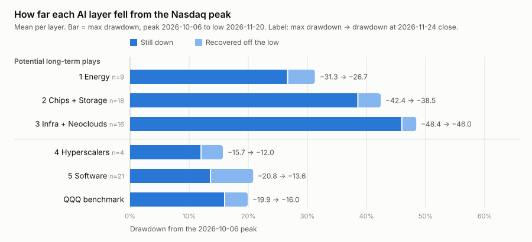
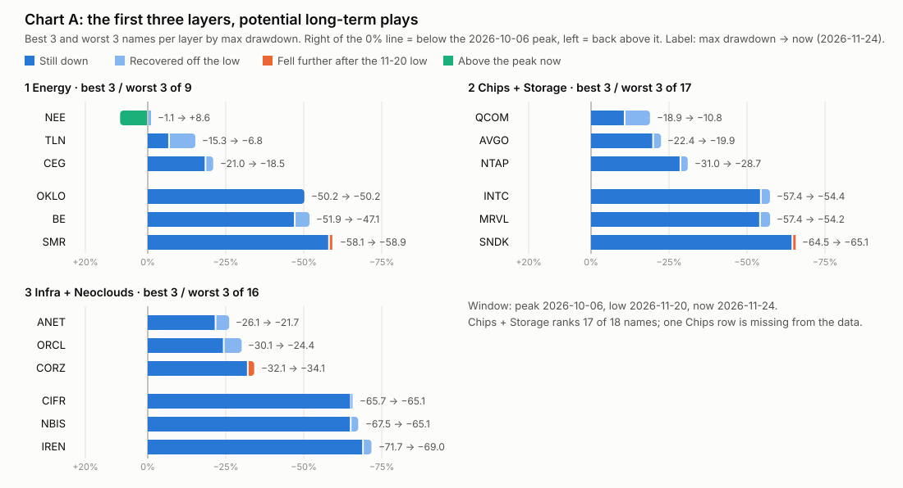
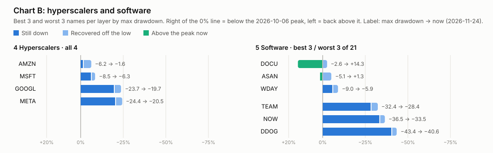

Software was written off as a casualty of AI. I think the market priced that with too broad a brush, and there's a potential mispricing in it. The next cycle is about which software gets paid for the complexity it carries.

<!--more-->

## What's happening in the market

I split the AI trade into five layers, loosely following Jensen Huang's AI cake (more in section 1), and tracked a basket of names in each:

1. **Energy:** power generation and nuclear, such as VST, CEG and OKLO.
2. **Chips + Storage:** the silicon and memory behind AI, such as NVDA, AVGO, MU and SNDK.
3. **Infra + Neoclouds:** data-centre equipment and the GPU clouds built on it, such as ANET, VRT, NBIS and IREN.
4. **Hyperscalers:** MSFT, AMZN, GOOGL and META.
5. **Software:** 21 names from infra and security to workflow, such as NET, SNOW, CRWD, DDOG and ASAN.

The first three layers are the ones I see as potential long-term plays.

The Nasdaq peaked on 2026-10-06 and bottomed on 2026-11-20, with QQQ down 19.9% at the low and 16.0% as of the 11-24 close. The pain wasn't evenly spread. Splitting the AI stack by layer, the layers closest to the hardware fell hardest: infra and neoclouds averaged −48.4% at the low, and chips and storage −42.4%. Energy fell 31.3%. Hyperscalers held up best at −15.7%, and software sits in between at −20.8%, close to the index, and has bounced back further since the low (−13.6% now).

The charts below show it by layer, then by name. All the price data comes from my own homelab, from the daily stock prices in my ClickHouse warehouse.

## 1. The cake: energy has to keep up

Jensen Huang describes AI as a five-layer cake: energy, chips, infrastructure, models, applications. Each layer sits on the one below it. The cake only gets taller if the bottom layers do.

In the US the bottom layer is the constraint. Data centres and AI hardware need power, and grid build-out, generation and interconnects move far slower than chip orders do. Energy has to keep pace with DC demand, or the layers above it stall. And right now I think the energy side is cooling, because the push to slow DC build-out keeps getting louder. Data-centre backlash helped Democrats win the midterms: local ballot measures limiting construction passed in 40 of 41 cases ([Washington Post](https://www.washingtonpost.com/ripple/2026/11/24/backlash-against-data-centers-helped-democrats-win-midterms/)). Now some incoming House Democrats want a national moratorium on new AI data centres ([Planetizen](https://www.planetizen.com/news/2026/11/138921-some-incoming-leading-us-house-dems-urge-national-moratorium-new-data-centers)), on top of the moratorium bill AOC already put forward. None of it is law yet, but every round of it lands on the names whose growth depends on DC demand. That puts the bottom of the cake at risk.

The person who drew the cake had his own drama in the same window. Jensen Huang resigned as Nvidia's CEO in mid-November, and the board reinstated him 11 days later ([Nvidia](https://nvidianews.nvidia.com/news/nvidia-board-reinstates-jensen-huang-as-president-ceo-and-board-director), [CNBC](https://www.cnbc.com/2026/11/24/nvidia-jensen-huang-ceo-return.html)). The Nasdaq low on 11-20 landed in the middle of that exile, and NVDA closed up 31.5% on 11-23, the day he came back. The investigations aren't over, so the chips layer still carries a governance overhang on top of the policy one.

## 2. AI infra is rotating, and the hyperscalers are the controlled part

The AI infra trade is rotating. Money is moving between the layers and between names instead of lifting everything together. The drawdown was deep in infra, neoclouds, chips and storage. It was controlled only at the hyperscalers.

The hyperscalers are the downstream consumers of AI infra. They buy the chips, the equipment and the power, then sell the result as cloud, ads and enterprise contracts. Those other businesses stand alongside the AI spend and cushion them, which is why their drawdowns are shallower than the pure-play infra names.

GOOGL is the exception to the pure-consumer picture. It builds its own chips (TPUs), so it is climbing up the cake and taking a bigger slice of the layers beneath it, instead of just paying for them.

My read is that capital rotates up the cake. It left the bottom layers for a while and is now looking at the layers where AI turns into revenue, which is software.

## 3. Which software holds up: three complexities

"Software" is too broad a bucket. First, a note: application complexity is no longer a moat. If a product's value is mostly its interface and workflow, a model, or a team with a model, can reproduce it. In my view three other kinds of complexity decide how well a software company holds up in the AI era:

1. **Infra complexity.** Whether the product has to run reliably at scale (traffic, data volume, uptime), which a model can't do for you directly.
2. **Operational complexity at different scales.** Whether that operational burden is still hard to replace at every customer size: small teams can use cheaper tools, and the biggest companies can build it in-house.
3. **Compliance and governance complexity.** Whether a big enterprise needs an accountable external party to manage the risk (security, audit, data residency, access control).

A company with none of the three is exposed. A company with all three gets stronger as agents multiply, because agents create more traffic, more data and more attack surface. I'm not going to sort the group into winners and losers, because every company here is dynamic and still earning its place. Most names span more than one complexity, so here is a simple read on each:

- **NET** (infra). It sits in the traffic path, so it benefits from agentic traffic directly.
- **SNOW** (infra, governance). Data gravity plus governance.
- **DOCU** (governance). I'd pair it with SNOW: Snowflake is where enterprise data sits, and Docusign is where agreement data is signed and audited. Its IAM platform grew from 12.6% to 15.1% of ARR in one quarter ([summary](https://za.investing.com/news/stock-market-news/docusign-q2-fy27-slides-iam-platform-drives-9-revenue-growth-93CH-4453938)), and it sells inside Anthropic's Cowork ([announcement](https://www.docusign.com/company/news-center/docusign-partners-with-anthropic-to-bring-its-intelligent-contract-workflows-to-cowork)), so models are a channel, not a replacement. It is 14.3% above its October peak.
- **CRWD** (governance). The clearest compliance and governance play. More agents means more endpoints, identities and attack surface, and the buyer needs an accountable external vendor.
- **Asana and Figma** (thin on all three). Both have been sold down so hard that they barely move, and neither trades as high-growth SaaS now. Figma's risk is prototyping becoming open to any LLM or to tools like [Open Design](https://open-design.ai/), which would make a comeback hard.

The pattern: the names that fit benefit from agentic usage, or are what large enterprises will always want managed externally. Cyber security and data are the two I trust most.

One more thing I look for is platforms that are hard to move out of and priced on usage. The more AI a company runs in production on them, the more of its data, dashboards and agents sit there, so leaving gets harder over time, and their growth follows how much AI work all their customers run combined.

<!-- TODO: Asana, add research on the governance complexity angle. -->

## Case study: Datadog

DDOG is a weird combination, and a special case because this one is post-analysis. It already happened, so I'm reading it in hindsight, not calling it. It was the hardest hit of the software names I track, down 43.4% at the low and still 40.6% below its peak. Its Q3 revenue grew about 35%, but its largest AI customer cut usage and several big AI customers renewed at better volume pricing, and the shares fell sharply ([Q3 recap](https://zacks.com/stock/news/3024408/ddog-q3-earnings-call-highlights-ai-growth-and-customer-renewals)).

### What I take from it

As an engineer, I'm not super surprised by the outcome. DDOG has a great product, and probably made observability UX so good that people are willing to pay a lot for it (it was my own go-to choice as a startup tech lead, back in the pre-agentic era). But from what I know:

1. **It's really a lot of money.** For a well-known example of how big a Datadog bill can get, see [Datadog's $65M/year customer mystery](https://newsletter.pragmaticengineer.com/p/datadogs-65myear-customer-mystery) from The Pragmatic Engineer.
2. **The moat isn't that high.** Grafana is mature and works well. The moat is really the UX and DX, not the product itself, and with AI-assisted development I don't think an in-house replica is hard to build. There are also inferior but cheaper replacements at almost every scale: cloud-native tooling, Sentry, and niche ones like Logfire for startups. So Datadog's growth is limited by how many customers it can keep, not only by how much AI they run.

So looking back, DDOG has infra complexity, but its operational complexity doesn't hold at every scale. Small teams have cheaper tools, and once a company is big enough, especially a tech company, it wants the economies of scale of building that in-house. Agents will boost DDOG's usage for sure, but they may also push the bigger customers to become self-reliant. That's the other side of usage-priced growth: it follows AI usage up, and a few big customers can pull it back.

### The same pattern elsewhere

Databricks is one I'd watch. I see its core competence as Unity Catalog, which is a governance and compliance play, along with features like Delta Sharing and clean rooms. Managed Spark was an infra complexity and still partly is. DLT isn't either of those, and neither is Lakebase, so I think they could face the same fate as DDOG's long tail: cheaper and good-enough alternatives exist.

Atlassian is the other, and the one I'd watch most. Docs should be purely agentic. No one likes writing docs, and people certainly want AI to write them. Jira is falling as well. I think the human attention layer should move above the ticket level soon. Jira will stay around for banks and governments (if they aren't using spreadsheets) because of governance complexity. But it isn't cheap either, and cutting that cost is an easy, high-impact win for whoever in those organisations takes the credit for it. If Atlassian doesn't move fast enough, it could end up in a similar spot.

## The takeaway

Infra built the cake. Now the question is who gets paid for what runs on top of it. I think the answer is software that is hard to run at every scale and hard to be accountable for.

Software is going to be hard waters to navigate, given how much complexity sits inside it. But if it's traded right, I think it can be high growth and high return.
